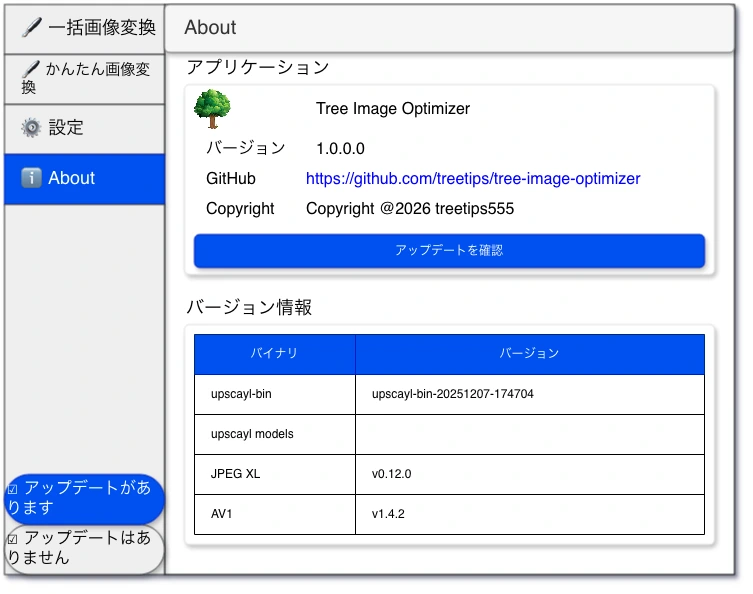

# About画面



## ✳️アプリケーション

- 表形式で表示します。

### ✏️ アプリケーション名

#### アプリアイコン

- アイコン `assets/images/icon-tree-01.png` を `縦50px（アスペクト比を維持）` で表示。

#### 静的ラベル

- 固定で `Tree Image Optimizer` と表示。

### ✏️ バージョン番号

#### 静的ラベル

- 固定で `バージョン` と表示。

#### 動的ラベル

- `1.0.0` の部分はアプリケーションのバージョン番号です。
- `Major` `Minor` `Patch` を使った [セマンティックバージョニング](https://semver.org/lang/ja/) を採用します。

#### バージョニング例

```text
1.0.0 : 初期バージョン
1.0.1 : バグを修正した
1.1.0 : 機能強化を行った
1.1.1 : 機能強化のバグを修正した
2.0.0 : 互換性を保証できない大きな機能強化を行った
```

### ✏️ GitHub

#### 静的ラベル

- 固定で `GitHub` と表示。

#### 動的ラベル

- リンク形式（クリックでブラウザが開く）で `https://github.com/treetips/tree-image-optimizer` を表示します。

### ✏️ copyright

#### 静的ラベル

- 行見出しに固定で `Copyright` と表示。
- 行の値に固定で `Copyright @2026 treetips555` と表示。

### ✏️ アップデートを確認

アプリケーション情報の下（カード内）に表示します。

#### ボタン

- `アップデートを確認` ボタンをクリックすると、アップデートチェックをします。
  - 更新情報は GitHub Releases の `update-info.json` から取得します。
  - アップデートが有る場合は `v<バージョン> が利用できます。` を表示し、
    インストール確認ダイアログを開きます。
  - アップデートが無い場合は `アプリは最新バージョンです。` を表示します。
- `アップデートを確認` ボタンをクリックすると、ボタンアイコンをローディングにし非活性にする。正常・異常に関わらず、処理が完了したらボタンを元の状態に戻す。
- インストール中もボタンは非活性にします。

### アップデート結果

#### alert

- `アップデートボタン` をクリックした際に表示します。初期状態で非表示です。表示ルールは [共通_alert](./common.md) を参照。
- 一度alertが表示されると、左サイドナビでメニューをクリックして別画面に遷移しても表示されっぱなしになります。
- 既にalertが表示されている状態から再度 `アップデートを確認ボタン` をクリックした場合、最新の情報でalertが置き換わります。

#### 更新カード

- `アップデートを確認` ボタンの結果は、alertに加えて左サイドナビ下部の更新カードにも表示します（詳細は [アプリケーションの更新](./update-application.md) の「更新カード仕様」を参照）。
- アップデートが有る場合は `アップデートが有ります` カード、無い場合は `アップデートは有りません` カードを表示します。
- アップデートチェックに失敗した場合は、更新カードを変更せずalertだけで失敗を通知します。

## ✳️ バージョン情報

- 表形式で全行を表示し、内容量に関わらずスクロールバーが発生しないようにします。
- バージョンは定数で管理し、各ツールの `.version` と同じ値にします。

### ✏️ upscayl-bin

#### 静的ラベル

- `upscayl-bin` という静的ラベルを表示します。

#### 動的ラベル

- 現在のバージョン（例: `upscayl-bin-20251207-174704`）を表示します。
- 値は定数から取得します。

### ✏️ Real-CUGAN

#### 静的ラベル

- `Real-CUGAN` という静的ラベルを表示します。

#### 動的ラベル

- 現在のバージョン（例: `realcugan-ncnn-vulkan-20220728`）を表示します。
- 値は定数から取得します。

### ✏️ JPEG

#### 静的ラベル

- `JPEG (jpegoptim)` という静的ラベルを表示します。

#### 動的ラベル

- 現在のバージョン（例: `v1.5.6`）を表示します。
- 値は定数から取得します。

### ✏️ PNG

#### 静的ラベル

- `PNG (pngoptim)` という静的ラベルを表示します。

#### 動的ラベル

- 現在のバージョン（例: `v0.6.3`）を表示します。
- 値は定数から取得します。

### ✏️ JPEG XL

#### 静的ラベル

- `JPEG XL (libjxl)` という静的ラベルを表示します。

#### 動的ラベル

- 現在のバージョン（例: `v0.13.0`）を表示します。
- 値は定数から取得します。

### ✏️ AV1

#### 静的ラベル

- `AV1 (libavif)` という静的ラベルを表示します。

#### 動的ラベル

- 現在のバージョン（例: `v1.4.2`）を表示します。
- 値は定数から取得します。

### ✏️ WebP

#### 静的ラベル

- `WebP (libwebp)` という静的ラベルを表示します。

#### 動的ラベル

- 現在のバージョン（例: `1.6.0`）を表示します。
- 値は定数から取得します。
