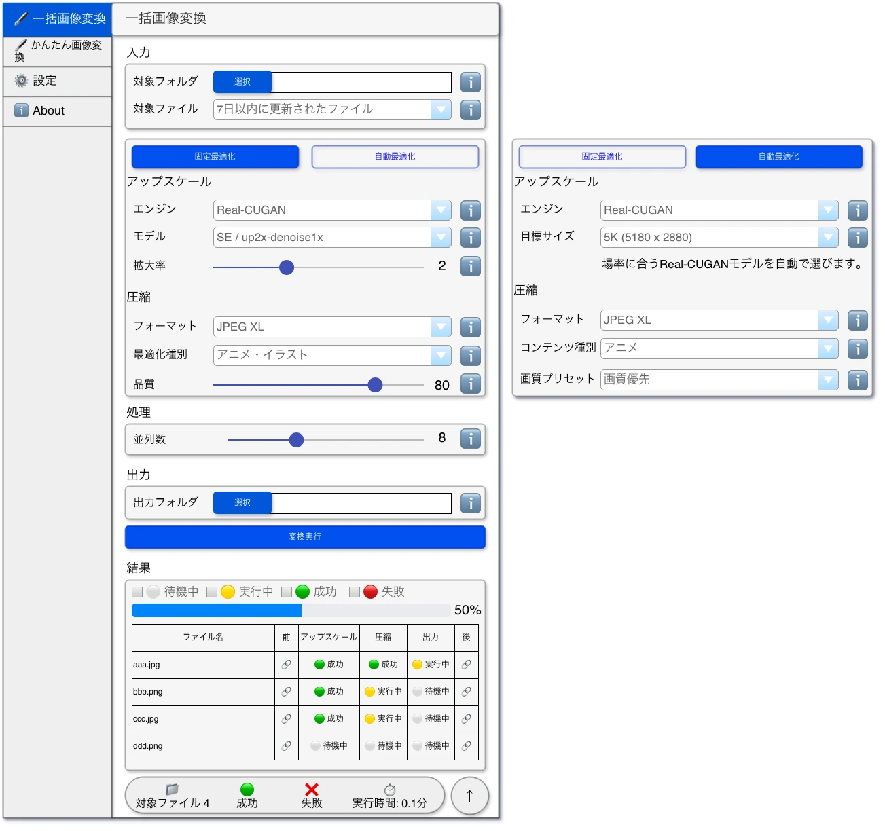

# 一括画像変換画面

画面は縦に長いので、スクロールが発生します。

## ✳️ 入力

### ✏️ 対象フォルダ

#### 静的ラベル

- `対象フォルダ` という静的ラベルを表示します。

#### 選択ボタン

- `フォルダ` を選択させます。このフォルダに存在する画像ファイル一式が対象ファイルになります。

#### 対象テキストボックス

- `選択ボタン` で選択したフォルダのパスが表示されます。
- 自分でパスを入力することも可能です。
- onChange で `対象テキストボックス` に入力されたパスが存在するかをチェックします。
  - 存在しない場合、テキストボックスのボーダーをバリデーションエラーの `赤色` に設定します。
  - 存在する場合、テキストボックスのボーダーを通常に戻します。

#### ℹ️

- ホバーするとpopoverに説明が表示される。
- 「対象フォルダ内のファイル一覧が対象になります。」というテキストが記述されていること。

### ✏️ 対象ファイル

#### 静的ラベル

- `対象ファイル` という静的ラベルを表示します。

#### 対象プルダウン

- 対象ファイルの中から、n日以内に更新されたファイルのみを対象とする、絞り込みを行うことができます。
- 選択肢は以下の通りです。
  - 1日以内に更新されたファイル
  - 3日以内に更新されたファイル
  - 7日以内に更新されたファイル
  - 30日以内に更新されたファイル
  - 全ファイル

#### ℹ️

- ホバーするとpopoverに説明が表示される。
- 「対象ファイルを絞り込むと処理する対象が減り、高速化します。」というテキストが記述されていること。

### ✏️ 対応フォーマット

#### 対応フォーマットのコールアウト

- 対象ファイルの下に、入力として受け付ける拡張子をバッジで表示します。
- 見出しをクリックすると開閉します。展開状態は `settings.json` の
  `batchConvert.formatsExpanded` に保存します。
- 表示する拡張子は、アプリが受け付ける拡張子の定義を正とします。
  - `jpg` / `jpeg`
  - `png`
  - `webp`
  - `heic` / `heif`
  - `avif`
- アニメーション形式（`gif` / APNG 等）は対象外です。
- 「以下の拡張子の画像を変換できます。」というテキストを表示します。

## ✳️ 最適化設定

### ✏️ モード

#### モードタブ

- `固定最適化` と `自動最適化` を切り替えるタブを、設定カードの先頭に表示します。
- 選択中はテーマカラーの枠とラジオで示します。未選択側も枠を描き、押せることを示します。
- 初期値は `固定最適化` です。
- `固定最適化` は全ファイルに同じ拡大率・品質を使います。
- `自動最適化` は画像ごとに目標サイズとファイルサイズを確認し、拡大率と圧縮品質を調整します
  （[ADR 0049](../../adr/0049-adaptive-conversion.md)）。

#### ℹ️

- ホバーするとpopoverに説明が表示される。
- 「固定は全ファイルに同じ設定を使います。自動は画像ごとに目標解像度と圧縮品質を合わせます。」というテキストが記述されていること。

#### モードの説明パネル

- モードタブの直下に、選択中モードの概要・得意・不得意を開閉パネルで表示します。
- 見出しにはモード名とアイコンを使い、クリックで開閉できます
  （[ADR 0074](../../adr/0074-collapsible-callout-panels.md)）。
- 初期状態は展開です。展開状態は `settings.json` の `batchConvert.modeNoteExpanded` に保存します。

## ✳️ アップスケール

### ✏️ エンジン

#### 静的ラベル

- `エンジン` という静的ラベルを表示します。

#### エンジンプルダウン

- `upscayl-bin` と `Real-CUGAN` からアップスケーラーのエンジンを選択します。
- 選択肢は以下の通りです。
  - upscayl-bin
  - Real-CUGAN
- 初期値は `upscayl-bin` です。
- `Real-CUGAN` は必須ツールで、未配置なら起動時に自動ダウンロードします。通常は手動配置が不要です。
- 起動時の修復に失敗した場合は再試行画面になります。
- バイナリはあるがモデルが揃っていない場合、選択肢の下に
  `Real-CUGANのツールが配置されていないため、使用できません。` と表示し、実行を無効化します。
- エンジンごとに前回のモデルを記憶し、切り替え時に復元します。

#### ℹ️

- ホバーするとpopoverに説明が表示される。
- 「アップスケーラーのエンジンを選択することができます」というテキストが記述されていること。

### ✏️ モデル

#### 静的ラベル

- `モデル` という静的ラベルを表示します。

#### モデルプルダウン

- アップスケールのモデルによって、得意な画像の種類が異なります。
- `upscayl-bin` では、[upscale models](./initial-data.md) の `.bin` 一覧を表示します。
- `Real-CUGAN` のモデルは、フォルダ名とファイル名を結合したID
  （例: `models-se/up2x-conservative`）で扱います。
  - 選択中の拡大率に合うモデルだけを選択肢に表示します。
  - 表示順はノイズ除去が弱い順（no-denoise → conservative → denoise1x → denoise2x →
    denoise3x）です。
  - `自動最適化` ではモデルプルダウンを表示せず、倍率に合うモデルを自動で選びます。
- 初期値はアニメに強い `realesr-animevideov3-x4` です。

#### ℹ️

- ホバーするとpopoverに説明が表示される。
- `upscayl-bin` では「realesr-animevideov3-x4がアニメに強いモデルです。」というテキストが記述されていること。
- `Real-CUGAN` では「Real-CUGANのモデルを選択します。conservativeはノイズをあまり除去せず、denoiseNはノイズを強く除去します。」というテキストが記述されていること。

### ✏️ 拡大率

#### 静的ラベル

- `拡大率` という静的ラベルを表示します。

#### 拡大率スライダー

- `固定最適化` のときだけ表示します。
- 最小 = `1` 、 最大 = `4` のスライダーです。例えば `2` だと `画像を2倍のサイズに拡大` します。アスペクト比は維持されます。
- `Real-CUGAN` では1xモデルが無いため、最小 = `2` 、 最大 = `4` です。
- 初期値は `2` です。
- 2 ~ 3 までのスライダーメモリを黄色で表示、 3 ~ 4 までのスライダーメモリを赤色で表示します。

#### ℹ️

- ホバーするとpopoverに説明が表示される。
- 「拡大する程処理速度が低下し、ファイルサイズが大きくなります。」というテキストが記述されていること。

### ✏️ 目標サイズ

#### 静的ラベル

- `目標サイズ` という静的ラベルを表示します。

#### 目標サイズプルダウン

- `自動最適化` のときだけ表示します。
- 画像の長辺を目標に合わせます。既に目標以上の画像は拡大しません。
- 選択肢は以下の通りです。
  - 2K (1920×1080)
  - 4K (3840×2160)
  - 5K (5120×2880)
  - 8K (7680×4320)
- 初期値は `5K (5120×2880)` です。
- 元画像と目標の差が僅かな場合は超解像を使わず、高品質リサイズで目標に合わせます。
- `Real-CUGAN` のときは、`倍率に合うReal-CUGANモデルを自動で選びます。` と表示します。

#### ℹ️

- ホバーするとpopoverに説明が表示される。
- 「長辺を目標に合わせます。既に目標以上の画像は拡大しません。」というテキストが記述されていること。

## ✳️ 圧縮

### ✏️ フォーマット

#### 静的ラベル

- `フォーマット` という静的ラベルを表示します。

#### フォーマットプルダウン

- アップスケールしただけだとファイルサイズが大きいので、圧縮率が高く劣化が少ない圧縮処理を行います。
- 選択肢は以下の通りです。
  - JPEG
  - PNG
  - JPEG XL
  - AV1
  - WebP
- 初期値は `JPEG XL` です。

#### ℹ️

- ホバーするとpopoverに説明が表示される。
- 「JPEG XLはアニメに強く、圧縮速度も速く、劣化を抑えることができます。」というテキストが記述されていること。

### ✏️ 最適化種別

#### 静的ラベル

- `最適化種別` という静的ラベルを表示します。

#### 最適化種別プルダウン

- `固定最適化` のときだけ表示します。
- JPEG XLやAV1のオプションで、画像の傾向（アニメや実写等）によって最適な数値が異なります。
- 選択肢は以下の通りです。
  - アニメ・イラスト
  - 実写・写真
  - 速度優先
  - 画質優先

#### ℹ️

- ホバーするとpopoverに説明が表示される。
- 「アニメや実写など、種別によって適したパラメータで圧縮します。」というテキストが記述されていること。

### ✏️ 品質

#### 静的ラベル

- `品質` という静的ラベルを表示します。

#### 品質スライダー

- `固定最適化` のときだけ表示します。
- `100` の場合は圧縮率は最低で、劣化は最小ですがファイルサイズが大きくなります。
- 最小 = `1` 、 最大 = `100` のスライダーです。
- 初期値は `80` です。劣化が少なく速度も速くバランスが取れている数字です。
- 80 ~ 90 までのスライダーメモリを黄色で表示、 90 ~ 100 までのスライダーメモリを赤色で表示します。

#### ℹ️

- ホバーするとpopoverに説明が表示される。
- 「JPEG XLはアニメに強く、圧縮速度も速く、劣化を抑えることができます。」というテキストが記述されていること。

### ✏️ コンテンツ種別

#### 静的ラベル

- `コンテンツ種別` という静的ラベルを表示します。

#### コンテンツ種別プルダウン

- `自動最適化` のときだけ表示します。
- 画像の傾向を選び、圧縮パラメータのベースにします。
- 選択肢は以下の通りです。
  - アニメ・イラスト
  - 実写・写真

#### ℹ️

- ホバーするとpopoverに説明が表示される。
- 「アニメは色差を保持し、実写はSVT-AV1で高速に圧縮します。」というテキストが記述されていること。

### ✏️ 画質プリセット

#### 静的ラベル

- `画質プリセット` という静的ラベルを表示します。

#### 画質プリセットプルダウン

- `自動最適化` のときだけ表示します。
- 品質値の基準と、エンコーダの速度・圧縮効率をまとめて切り替えます。
- 選択肢は以下の通りです。
  - 画質最優先
  - 画質優先
  - 速度優先
  - 速度最優先
- 初期値は `画質優先` です。
- ファイルサイズが大きい（BPPが高い）画像ほど、品質値を下げて強く圧縮します。

#### ℹ️

- ホバーするとpopoverに説明が表示される。
- 「画質と速度のバランスです。ファイルサイズが大きい画像はより強く圧縮します。」というテキストが記述されていること。

## ✳️ 処理

### ✏️ 並列数

#### 静的ラベル

- `並列数` という静的ラベルを表示します。

#### スライダー

- 最小を `1` 、 最大を `Pコア数` とします。
  - Apple Siliconでは `sysctl hw.perflevel0.logicalcpu` で取得します。
  - 取得できない環境では全論理コア数を使います。
- デフォルト値は `Pコア数 / 2`（端数切り捨て、最低 `1`）を指定してください。
  - 動画視聴やブラウジングを妨げない負荷を既定にするため、最大までは使いません。
  - かんたん変換画面にも同じ値を使います。かんたん変換画面にはスライダーが無いため、
    既定値がそのまま負荷の既定値になります。
- スライダーに現在の設定値を表示してください。
- 色は `設定値 / 最大` の割合で決めます。
  - `0.7` 未満 : アクセントカラー（青）
  - `0.7` 以上 `0.9` 未満 : 黄色
  - `0.9` 以上 : 赤
- エンコーダ全体のスレッド数は `並列数` ぶんに抑えているため、割合がそのままCPU負荷の
  目安になります。詳細は [ADR 0039](../../adr/0039-parallel-is-load-budget.md) を参照してください。

## ✳️ 出力

### ✏️ 出力フォルダ

#### 静的ラベル

- `出力フォルダ` という静的ラベルを表示します。

#### 選択ボタン

- `フォルダ` を選択させます。このフォルダに圧縮したファイルを出力します。

#### 対象テキストボックス

- `選択ボタン` で選択したフォルダのパスが表示されます。
- 自分でパスを入力することも可能です。
- onChange で `対象テキストボックス` に入力されたパスが存在するかをチェックします。
  - 存在しない場合、テキストボックスのボーダーをバリデーションエラーの `赤色` に設定します。
  - 存在する場合、テキストボックスのボーダーを通常に戻します。

#### ℹ️

- ホバーするとpopoverに説明が表示される。
- 「出力先に既に同一のファイル名が存在する場合、上書きコピーされます。」というテキストが記述されていること。

## ✳️ 実行

### ✏️ 実行ボタン

- `実行` という静的ラベルをボタンに表示します。
- 実行中はラベルを `変換中...` に変え、多重クリック防止のため非活性にします。
- 初期状態では非活性で、次のすべてを満たす場合だけ活性化します。
  - `対象フォルダ` と `出力フォルダ` が入力済み
  - どちらのパスにもバリデーションエラーが無い
  - ツールの準備が完了している
  - `Real-CUGAN` を選んでいる場合は Real-CUGAN のツールが揃っている
- 実行ボタンクリック時に、 `結果` の要素全てを `初期値` に戻してから変換を実行します。
- 実行ボタンクリック時は、実行結果が見えるよう画面下部へ自動スクロールします。
- 全ファイルの処理が終わると、実行結果の上に結果メッセージを表示します。
  - 全ファイル成功: `変換完了：成功N件`
  - 失敗あり: `変換完了：成功N件・失敗M件`
  - キャンセル: `キャンセルしました：成功N件・未完了M件`
- 失敗した行が残っている場合は `失敗したファイルを再実行` ボタンを表示し、
  成功済みの行を残したまま失敗行だけを再実行できます
  （[ADR 0066](../../adr/0066-convert-retry-failed.md)）。

### ✏️ 一時停止・キャンセル

- 実行中だけ、実行ボタンの下に `一時停止` と `キャンセル` を表示します
  （[ADR 0054](../../adr/0054-convert-pause-cancel.md)）。
- `一時停止` を押すとラベルが `再開` に変わり、実行中のバッチが終わった区切りで待機します。
  再開すると、停止前の進捗と処理枠のまま続きから処理します。
- `キャンセル` を押すと確認ダイアログを表示し、実行中の外部プロセスを終了します。
  出力済みのファイルは残り、途中で止めた段階は `キャンセル` として表示します。
- 一時停止中は `一時停止中`、キャンセル処理中は `キャンセル中...` と表示します。

#### 変換完了時のアクション

##### OSの通知

設定画面で `OSの通知を表示する` にチェックが付いている場合、OSの通知を表示します。

- 全ファイル変換成功した場合
  - 通知のタイトル: `tree-image-optimizer`
  - 通知の本文: `🟢 変換処理が成功しました。`
- 1ファイルでも変換が失敗している場合
  - 通知のタイトル: `tree-image-optimizer`
  - 通知の本文: `🔴 変換処理が失敗しました。`

##### サウンドの再生

設定画面で `サウンドを再生する` にチェックが付いている場合、サウンドを再生します。

- 全ファイル変換成功した場合
  - `設定画面` で選択した `成功時のサウンド` を再生します。
- 1ファイルでも変換が失敗している場合
  - `設定画面` で選択した `失敗時のサウンド` を再生します。

#### 処理フロー

[変換処理フロー](./convert-flow/convert-flow.md)

## ✳️ 実行結果

### ✏️ ⚪ 待機中チェックボックス

- 実行結果の表を絞り込んで表示する機能です。
- 1行単位で絞り込み判定をします。
- `アップスケール` `圧縮` `出力` の中で、一つでも対象を含む場合、その行を表示対象として残し、含まない場合はその行を非表示にします。
- 初期値で全てのチェックボックスにチェックが付いているので、全件表示されている状態です。
- 5つのチェックの選択状態は `settings.json` の `batchConvert` に保存し、次回起動時と
  画面の再表示時に復元します。詳細は [ADR 0041](../../adr/0041-persist-result-filter.md) を参照してください。

#### 静的ラベル

- `⚪ 待機中` という静的ラベルを表示します。

#### 待機中チェックボックス

- チェックを付けると、実行結果の表を `待機中` で絞り込みます。
- 初期値は `チェック済み` です。

### ✏️ 🟡 実行中チェックボックス

#### 静的ラベル

- `🟡 実行中` という静的ラベルを表示します。

#### 待機中チェックボックス

- チェックを付けると、実行結果の表を `実行中` で絞り込みます。
- 初期値は `チェック済み` です。

### ✏️ 🟢 成功チェックボックス

#### 静的ラベル

- `🟢 成功` という静的ラベルを表示します。

#### 待機中チェックボックス

- チェックを付けると、実行結果の表を `成功` で絞り込みます。
- 初期値は `チェック済み` です。

### ✏️ 🔴 失敗チェックボックス

#### 静的ラベル

- `🔴 失敗` という静的ラベルを表示します。

#### 待機中チェックボックス

- チェックを付けると、実行結果の表を `失敗` で絞り込みます。
- 初期値は `チェック済み` です。

### ✏️ ⏹ キャンセルチェックボックス

#### 静的ラベル

- `⏹ キャンセル` という静的ラベルを表示します。

#### キャンセルチェックボックス

- チェックを付けると、実行結果の表を `キャンセル` で絞り込みます。
- 初期値は `チェック済み` です。

### ✏️ 進捗表

- `進捗表` ・ `進捗率` ・ `結果表` は `リアルタイム` に更新されます。
- 表の高さは `360px` に固定し、それ以上の場合はスクロールバーを表示してください。
  行高の更新で外側のスクロールと制約の再計算が連鎖しないようにするためです
  （[ADR 0075](../../adr/0075-preview-layout-stability.md)）。

#### 1列目 ファイル名

- 対象ファイルのファイル名を表示する。

#### 2列目 前

- 変換前の画像リンク。
- `🔗` を固定表示。
- クリックすると `変換前の画像` を `Finder` で表示する。ファイルが存在しない際はポップオーバーで `ファイルが存在しません` と表示。

#### 3列目 アップスケール

- `⚪ 待機中` `🟡 実行中` `🟢 成功` `🔴 失敗` `⏹ キャンセル` のいずれかを表示します。
- 初期値は `⚪ 待機中` です。

#### 4列目 圧縮

- `⚪ 待機中` `🟡 実行中` `🟢 成功` `🔴 失敗` `⏹ キャンセル` のいずれかを表示します。
- 初期値は `⚪ 待機中` です。

#### 5列目 出力

- `⚪ 待機中` `🟡 実行中` `🟢 成功` `🔴 失敗` `⏹ キャンセル` のいずれかを表示します。
- 初期値は `⚪ 待機中` です。

#### 6列目 後

- 変換後の画像リンク。
- `🔗` を固定表示。
- クリックすると `変換後の画像` を `Finder` で表示する。ファイルが存在しない際はポップオーバーで `ファイルが存在しません` と表示。

#### 7列目 プレビュー

- 変換前と変換後の画像を並べた比較プレビューを表示します
  （[ADR 0071](../../adr/0071-convert-preview.md)）。
- 出力が成功した行だけ操作できます。クリックするとプレビューを開きます。

### ✏️ 進捗率

#### プログレスバー

- 最小 = `0%` 、 最大 = `100` で、成功・失敗に関わらず処理が全て終わると `100%` になります。
  キャンセル時は完了した件数までの進捗で止まります。
- `対象ファイル数` と `処理件数（成功・失敗・キャンセルに関わらず）` で進捗率を計算します。
- 表の1行の処理が全て終わったら進捗にカウントします。例えば `aaa.jpg` がアップスケールしか完了していないなら、進捗率は0%です。
- 初期値は `0%` です。

### ✏️ 結果表

- 画面下部に統計バーを固定して表示し、リアルタイムに値を更新します。
- 統計バーはLiquid Glassのフローティング表示です。

#### 対象ファイル数

- 縦に2段表示で、上段にアイコン・下段にテキスト（ラベル・値）を表示します。
- 上段
  - アイコンを表示します。アイコン種類は機能に適したものを選択してください。
- 下段
  - ラベルには `対象ファイル` と表示します。
  - 値には処理対象のファイル数を表示します。
  - 値の初期値は `0` です。

#### 成功件数

- 縦に2段表示で、上段にアイコン・下段にテキスト（ラベル・値）を表示します。
- 上段
  - アイコンを表示します。アイコン種類は機能に適したものを選択してください。
  - アイコンは `緑色` で表示します。
- 下段
  - ラベルには `成功` と表示します。
  - 値には処理に成功した件数を表示します。
  - 値の初期値は `0` です。

#### 失敗件数

- 縦に2段表示で、上段にアイコン・下段にテキスト（ラベル・値）を表示します。
- 上段
  - アイコンを表示します。アイコン種類は機能に適したものを選択してください。
  - アイコンは `赤色` で表示します。
- 下段
  - ラベルには `失敗` と表示します。
  - 値には処理に失敗した件数を表示します。
  - 値の初期値は `0` です。

#### 実行時間

- 縦に2段表示で、上段にアイコン・下段にテキスト（ラベル・値）を表示します。
- 上段
  - アイコンを表示します。アイコン種類は機能に適したものを選択してください。
- 下段
  - ラベルには `実行時間` と表示します。
  - 値には単位を `分` 、小数点第一位までで、実行した時間を表示します。
  - 値の初期値は `0分` です。

#### 残り時間

- 実行中だけ、実行時間の右に表示します。
- ラベルには `残り` と表示し、値は `分` 単位で小数点第一位まで表示します
  （[ADR 0067](../../adr/0067-convert-eta.md)）。
- 完了件数が増えないキャンセル待ちの間は表示しません。

## ✳️ 画面の先頭に戻る

### ✏️ 画面の先頭に戻るボタン

#### 静的ラベル

- `↑` という静的ラベルを表示します。
- 丸形のボタンです。

#### 選択ボタン

- 画面右下に固定でフローティング表示します。
- クリックすると画面の先頭にスクロールします。
