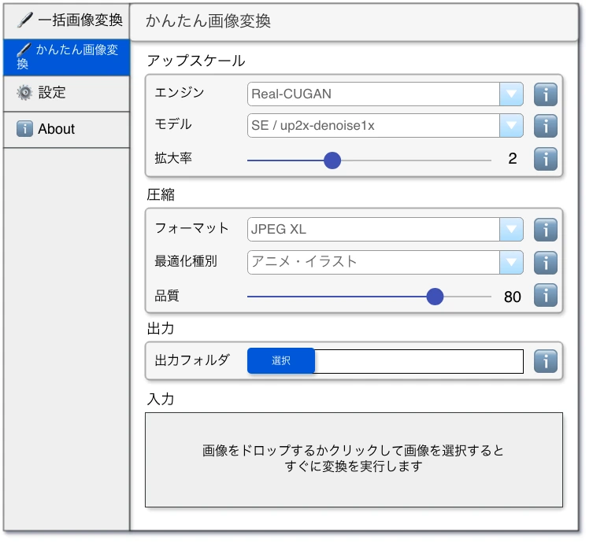

# かんたん画像変換画面

## ✳️ アップスケール

[一括画像変換のアップスケール](./batch-convert.md) と同じUI・機能です。
かんたん変換は常に固定最適化で、モードタブはありません。

### ✏️ エンジン

#### 静的ラベル

- `エンジン` という静的ラベルを表示します。

#### エンジンプルダウン

- `upscayl-bin` と `Real-CUGAN` からアップスケーラーのエンジンを選択します。
- 選択肢は以下の通りです。
  - upscayl-bin
  - Real-CUGAN
- 初期値は `upscayl-bin` です。
- `Real-CUGAN` は必須ツールで、未配置なら起動時に自動ダウンロードします。通常は手動配置が不要です。
- 起動時の修復に失敗した場合は再試行画面になります。
- バイナリはあるがモデルが揃っていない場合、選択肢の下に
  `Real-CUGANのツールが配置されていないため、使用できません。` と表示し、実行できなくします。

#### ℹ️

- ホバーするとpopoverに説明が表示される。
- 「アップスケーラーのエンジンを選択することができます」というテキストが記述されていること。

### ✏️ モデル

[一括画像変換のモデル](./batch-convert.md) と同じUI・機能です。
選択中のエンジンと拡大率に合うモデルだけを表示します。

### ✏️ 拡大率

[一括画像変換の拡大率](./batch-convert.md) と同じUI・機能です。
`Real-CUGAN` では2〜4、`upscayl-bin` では1〜4です。

## ✳️ 圧縮

[一括画像変換の圧縮](./batch-convert.md) と同じUI・機能です。
かんたん変換は固定最適化のため、`最適化種別` と `品質` を表示します。

### ✏️ 最適化種別

[一括画像変換の最適化種別](./batch-convert.md) と同じUI・機能です。

### ✏️ 品質

[一括画像変換の品質](./batch-convert.md) と同じUI・機能です。

## ✳️ 出力

[一括画像変換の出力](./batch-convert.md) と同じUI・機能です。
出力フォルダが未選択または不正な場合は、ドロップエリアに
`先に出力フォルダを選択してください` と表示し、変換を受け付けません。

## ✳️ 入力

### ✏️ 画像のドラッグドロップエリア

#### 画像のドラッグドロップエリアのアクション

- エリアに画像ファイルをドラッグドロップすると、即座に画像変換処理が実行されます。
  複数ファイルをまとめてドロップできます。
- 画像以外をドロップしても反応しません。
- エリアをホバーするとカーソルがポインターになります。
- エリアをクリックすると、ファイル選択ダイアログが表示され、ファイルを選択すると
  即座に画像変換処理が実行されます。複数選択できます。
- 画像変換前に、エリアの枠を標準に戻します。
- 画像変換に `成功` した場合、エリアの枠を `緑色` にします。
- 画像変換に `失敗` した場合、エリアの枠を `赤色` にします。
- 変換中はエリアを無効化し、進捗率を表示します。終了すると自動的に有効へ戻します。
- 変換結果のメッセージはエリア内に表示します。

#### 対応フォーマット

- ドロップエリアの直下に、入力として受け付ける拡張子をバッジで表示します。
- 表示する拡張子は、アプリが受け付ける拡張子の定義を正とします。
  - `jpg` / `jpeg`
  - `png`
  - `webp`
  - `heic` / `heif`
  - `avif`
- アニメーション形式（`gif` / APNG 等）は対象外です。
- 「以下の拡張子の画像を変換できます。」というテキストを表示します。

#### サウンドの再生

[一括画像変換のサウンド](./batch-convert.md) と同様に、変換終了時にサウンドを再生します。
